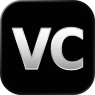

  

# VibeCodinger

VibeCodinger runs coding agents on your own machine and lets you continue a thread from a desktop, browser, or native phone app. It supports Codex, Claude Code, and other [agent providers](./docs/user/providers-acp.md), and gives each thread its own workspace and Git controls.

## Releases

The fork's [GitHub Releases](https://github.com/AkaakuHub/t3code/releases) page is the distribution location for Windows, Linux, macOS, and iPhone builds. An unsigned iPhone IPA must be signed before installation.

Start with a server and at least one configured agent. To connect another device securely over Tailscale, use the server's [direct TLS setup](./docs/user/remote-access.md#direct-tls-over-tailscale), then create a one-time code with `vibecodinger pair` and enter it in **Add Environment**.

## Development

Use the [development runbook](./docs/operations/00_development.md#first-checkout) to build from source. The [upstream review workflow](./.github/workflows/fork-upstream-review.yml) opens proposals for this fork. Review and merge them in GitHub.

VibeCodinger is an independent fork of the [upstream project](https://github.com/pingdotgg/t3code). The source code is available under the [MIT license](./LICENSE). See the [upstream trademark policy](./TRADEMARK.md).
